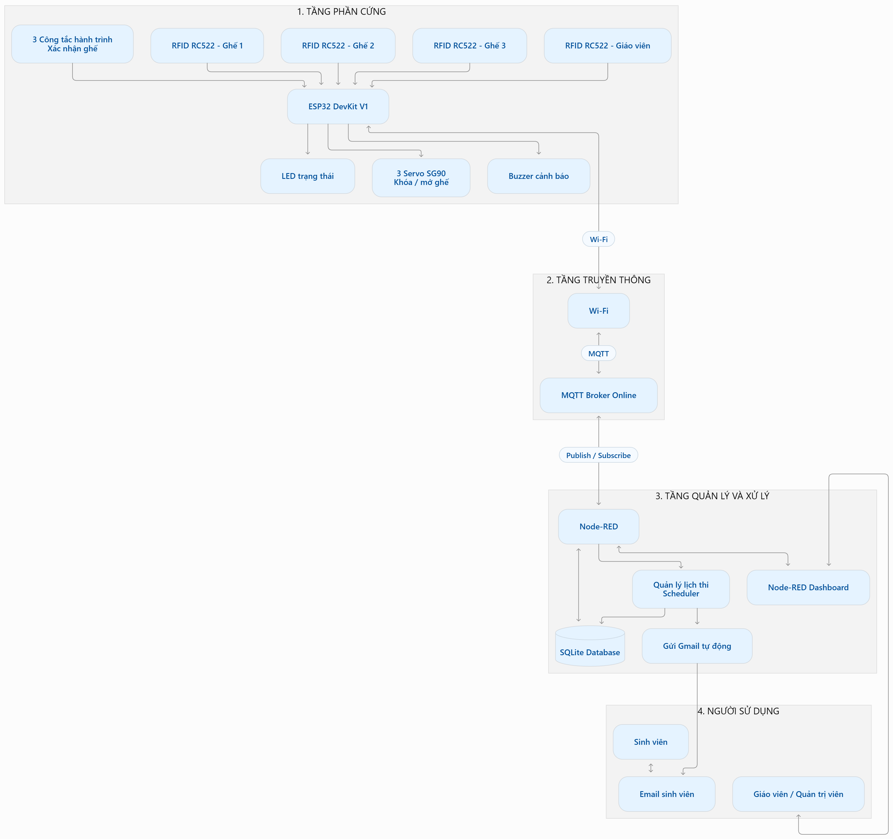
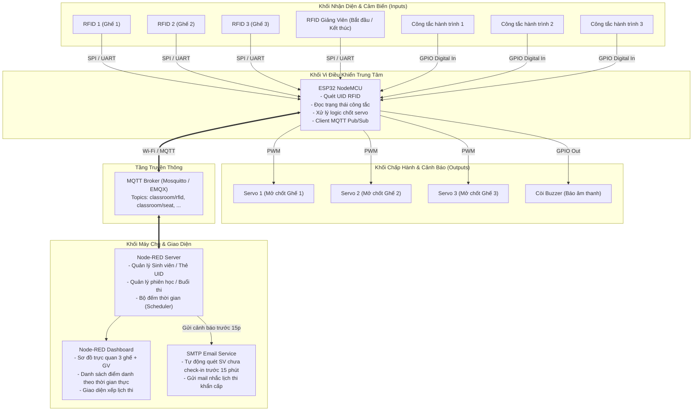
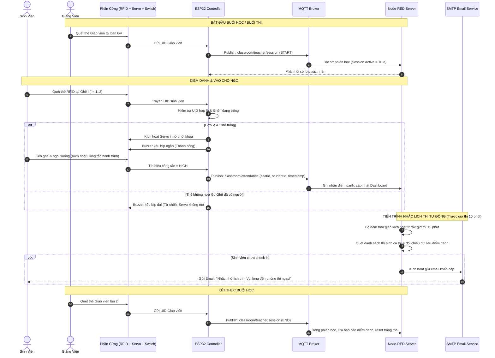
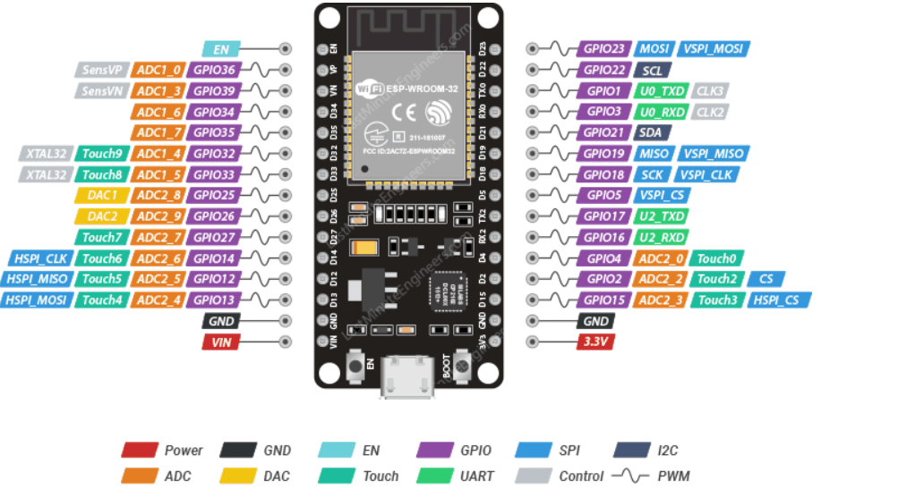
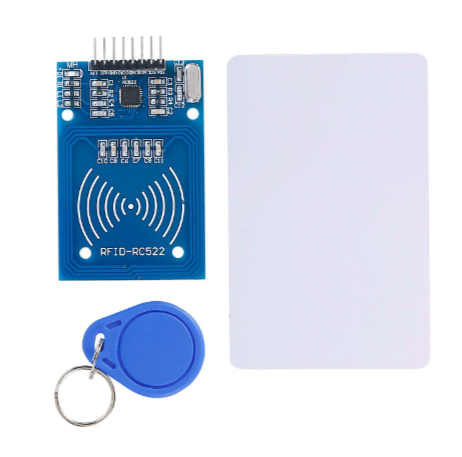
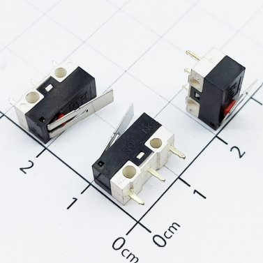
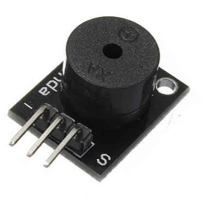
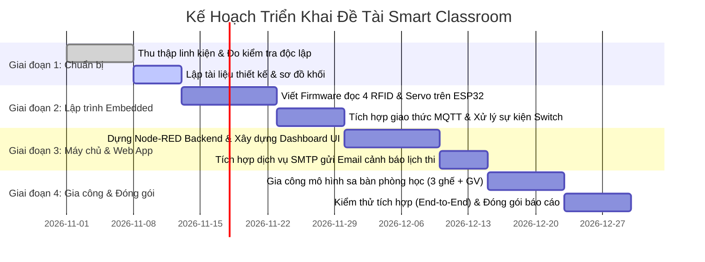

# 🏫 SMART CLASSROOM: HỆ THỐNG QUẢN LÝ PHÒNG HỌC, ĐIỂM DANH & NHẮC LỊCH THI

[](https://www.espressif.com/)
[](https://mqtt.org/)
[](https://nodered.org/)
[](#danh-mục-phần-cứng-dự-kiến)
[](#)

---

## 📖 MỤC LỤC
1. [Giới thiệu tổng quan & Đặt vấn đề](#1-giới-thiệu-tổng-quan--đặt-vấn-đề)
2. [Mục tiêu đề tài](#2-mục-tiêu-đề-tài)
3. [Kiến trúc hệ thống & Sơ đồ khối](#3-kiến-trúc-hệ-thống--sơ-đồ-khối)
4. [Các tính năng chính của hệ thống](#4-các-tính-năng-chính-của-hệ-thống)
5. [Nguyên lý hoạt động & Kịch bản thực tế](#5-nguyên-lý-hoạt-động--kịch-bản-thực-tế)
6. [Danh mục phần cứng dự kiến](#6-danh-mục-phần-cứng-dự-kiến)
7. [Thiết kế phần mềm & Giao thức kết nối](#7-thiết-kế-phần-mềm--giao-thức-kết-nối)
8. [Lộ trình triển khai (Roadmap)](#8-lộ-trình-triển-khai-roadmap)
9. [Tài liệu tham khảo (References)](#9-tài-liệu-tham-khảo-references)
10. [Thông tin tác giả](#10-thông-tin-tác-giả)

---

## 1. GIỚI THIỆU TỔNG QUAN & ĐẶT VẤN ĐỀ

Trong kỷ nguyên chuyển đổi số và phát triển trường học thông minh (Smart University / Smart Campus), công tác quản lý phòng học, kiểm soát hiện diện của sinh viên và tổ chức các kỳ thi đóng vai trò đặc biệt quan trọng. Tuy nhiên, các phương pháp quản lý truyền thống hiện nay đang bộc lộ nhiều hạn chế:
- **Điểm danh thủ công tốn thời gian:** Điểm danh bằng cách đọc tên hoặc ký tên vào danh sách giấy gây lãng phí từ 10 - 15 phút đầu mỗi buổi học và dễ xảy ra tình trạng ký tên hộ, điểm danh hộ.
- **Gian lận vị trí chỗ ngồi:** Điểm danh qua ứng dụng di động/quét mã QR dễ bị gửi mã ra ngoài cho người không có mặt trong lớp quét từ xa.
- **Khó quản lý ghế ngồi và tài nguyên phòng học:** Giảng viên và ban quản lý khó nắm bắt thời gian thực vị trí ghế nào đang trống, ghế nào có người ngồi.
- **Rủi ro sinh viên quên/lỡ lịch thi:** Sinh viên thường bỏ sót thông báo lịch thi hoặc nhầm phòng thi, dẫn đến việc vắng thi đáng tiếc.

Nhằm giải quyết triệt để các vấn đề trên, đề tài **"Smart Classroom - Hệ thống Quản lý Phòng học, Điểm danh và Nhắc lịch thi"** được nghiên cứu và phát triển. Dự án kết hợp công nghệ nhận dạng tần số sóng vô tuyến (**RFID**), cơ chế giám sát vật lý (**Servo Lock + Limit Switch**), mạng không dây và giao thức **MQTT**, cùng nền tảng quản trị trung tâm **Node-RED** nhằm tự động hóa hoàn toàn quy trình điểm danh, kiểm soát vị trí ngồi và nhắc lịch thi tự động qua Email.

---

## 2. MỤC TIÊU ĐỀ TÀI

- **Xây dựng mô hình thực nghiệm (Hardware Prototype):** Mô hình phòng học quy mô nhỏ gồm **3 vị trí ghế sinh viên** và **1 bàn giáo viên**, có cơ chế đóng/mở chốt cơ học và cảm biến lực/hành trình tại mỗi ghế.
- **Tự động hóa điểm danh và xác thực cá nhân:** Ứng dụng công nghệ RFID RC522 (13.56MHz) để xác định danh tính sinh viên và phân quyền giáo viên điều khiển buổi học.
- **Chống điểm danh hộ & xác thực hiện diện thực tế:** Kết hợp đọc thẻ với công tắc hành trình kiểm tra sinh viên có thực sự ngồi vào ghế hay không trước khi ghi nhận điểm danh.
- **Giao tiếp IoT thời gian thực (Real-time IoT Communication):** Tận dụng vi điều khiển ESP32 và giao thức MQTT để truyền nhận dữ liệu trạng thái nhanh chóng, độ trễ thấp và bảo mật.
- **Quản lý tập trung & Giám sát trực quan:** Xây dựng Dashboard trên nền tảng Node-RED hiển thị sơ đồ phòng học, trạng thái ghế, thống kê sĩ số và lịch sử ra vào.
- **Hệ thống nhắc thi tự động (Automated Exam Reminder):** Tích hợp dịch vụ gửi Email thông minh, tự động kiểm tra danh sách có mặt trước giờ thi 15 phút; nếu sinh viên chưa điểm danh tại phòng thi thì lập tức gửi email cảnh báo khẩn cấp.

---

## 3. KIẾN TRÚC HỆ THỐNG & SƠ ĐỒ KHỐI

### 3.1. Sơ đồ khối tổng thể (Block Diagram)

Dưới đây là sơ đồ khối kiến trúc phần cứng và luồng dữ liệu của hệ thống Smart Classroom:



### 3.2. Sơ đồ luồng hoạt động chi tiết (Architecture Flowchart)



### 3.3. Thuyết minh các khối chức năng

1. **Khối Vi điều khiển (Master MCU - ESP32):**
   - Đóng vai trò là trung tâm điều khiển tại phòng học.
   - Quản lý các module đọc thẻ RFID, đọc trạng thái đóng/ngắt của công tắc hành trình gắn dưới mặt ghế.
   - Xuất tín hiệu PWM điều khiển các động cơ servo mở khóa ghế khi thẻ hợp lệ.
   - Kết nối Wi-Fi phòng học, đóng vai trò MQTT Client giao tiếp hai chiều với Node-RED.
2. **Khối Nhận diện & Cảm biến (Inputs):**
   - **4 Module RFID RC522:** 3 đầu đọc gắn tại 3 vị trí ghế ngồi của sinh viên, 1 đầu đọc gắn tại bàn giảng viên.
   - **3 Công tắc hành trình (Microswitch):** Đặt tại khớp/mặt ghế nhằm phát hiện chính xác sinh viên đã kéo ghế và ngồi vào thực tế.
3. **Khối Cơ cấu chấp hành & Cảnh báo (Outputs):**
   - **3 Động cơ Servo SG90:** Điều khiển then/chốt cơ học; giữ ghế ở trạng thái khóa khi chưa có sinh viên điểm danh hợp lệ và mở chốt khi sinh viên quét thẻ thành công.
   - **Còi chip Active Buzzer:** Phát tín hiệu âm thanh phản hồi (bíp ngắn khi quẹt thẻ thành công; bíp dài khi thẻ không hợp lệ hoặc ghế đã có người).
4. **Khối Xử lý trung tâm & Dashboard (Node-RED Backend):**
   - Lưu trữ cơ sở dữ liệu sinh viên (Mã SV, Họ tên, UID thẻ, Email).
   - Tiếp nhận sự kiện điểm danh từ ESP32 qua giao thức MQTT.
   - Quản lý phiên học (Session) theo lệnh quẹt thẻ của giảng viên.
   - Quản lý danh sách thi, phòng thi và kích hoạt tiến trình tự động gửi email nhắc nhở trước giờ thi 15 phút.

---

## 4. CÁC TÍNH NĂNG CHÍNH CỦA HỆ THỐNG

| Nhóm tính năng | Mô tả chi tiết |
| :--- | :--- |
| **1. Quản lý Ghế & Điểm danh SV** | • Mỗi ghế gắn 1 đầu đọc RFID, 1 chốt servo và 1 công tắc hành trình.<br>• Sinh viên quét thẻ tại đúng ghế muốn ngồi để mở chốt ghế.<br>• Khi sinh viên ngồi xuống, công tắc hành trình đóng lại, hệ thống mới chính thức xác nhận điểm danh thành công qua MQTT.<br>• Từ chối và phát chuông báo động nếu quẹt thẻ đã được dùng, thẻ không thuộc danh sách, hoặc ghế đang có người ngồi. |
| **2. Phân quyền Thẻ Giáo Viên** | • Giáo viên sở hữu thẻ RFID Master.<br>• Quét thẻ lần 1: Mở phiên học/thi, bắt đầu cho phép sinh viên điểm danh.<br>• Quét thẻ lần 2: Đóng phiên, chốt danh sách có mặt/vắng mặt, khóa toàn bộ ghế chưa sử dụng. |
| **3. Quản lý Lịch thi Thông minh** | • Nhập và quản lý lịch thi trực tiếp trên Dashboard (Mã môn, Tên môn, Ngày thi, Giờ bắt đầu, Phòng thi, Danh sách thí sinh & Email).<br>• Tự động đối chiếu UID quẹt thẻ tại phòng với danh sách thí sinh của ca thi tương ứng. |
| **4. Tự động gửi Email Nhắc thi** | • Hệ thống chạy tiến trình kiểm tra tự động trước giờ thi chính xác **15 phút**.<br>• Lọc ra các sinh viên trong danh sách thi nhưng chưa check-in tại phòng.<br>• Tự động gửi email thông báo chi tiết: Môn thi, Phòng thi, Số báo danh và nhắc nhở đến phòng thi ngay. |
| **5. Giám sát Thời gian thực (Dashboard)**| • Hiển thị trực quan sơ đồ phòng học: Ghế trống (Xanh lá), Ghế đang sử dụng (Đỏ), Ghế đã mở chốt chờ ngồi (Vàng).<br>• Thống kê sĩ số lớp/ca thi: Tổng số, Đã có mặt, Chưa có mặt.<br>• Xem nhật ký (Log) điểm danh chi tiết kèm dấu thời gian (Timestamp). |

---

## 5. NGUYÊN LÝ HOẠT ĐỘNG & KỊCH BẢN THỰC TẾ



### Mẫu Email Nhắc Thi Tự Động (Email Template)
```text
Tiêu đề: [NHẮC NHỞ LỊCH THI] - Hệ thống Smart Classroom - Môn: Kỹ thuật Vi điều khiển

Chào bạn: Nguyễn Văn A (MSSV: 20230001),

Hệ thống ghi nhận bạn có lịch thi với các thông tin chi tiết sau:
- Môn thi: Kỹ thuật Vi điều khiển và IoT
- Thời gian thi: 08:00 - Ngày 15/12/2026
- Phòng thi: P.402 - Smart Classroom Lab
- Vị trí đăng ký: Khu vực Ghế A

⚠️ CẢNH BÁO: Hiện tại chỉ còn 15 PHÚT nữa là bắt đầu ca thi, nhưng hệ thống CHƯA GHI NHẬN bạn check-in bằng thẻ RFID tại phòng thi.
Vui lòng kiểm tra lại thông tin và nhanh chóng có mặt tại phòng thi để làm thủ tục.

Chúc bạn hoàn thành tốt bài thi!
-----------------------------------------------------------
Smart Classroom Management System - Automated Notification
```

---

## 6. DANH MỤC PHẦN CỨNG DỰ KIẾN

### 6.1. Bảng thông số linh kiện

| STT | Tên Linh Kiện | Hình Ảnh Minh Họa | Số Lượng | Thông Số Kỹ Thuật Chính | Vai Trò Trong Dự Án |
| :---: | :--- | :---: | :---: | :--- | :--- |
| 1 | **ESP32 NodeMCU-32S** | [Xem chi tiết](#62-hình-ảnh-chụp-phần-cứng-thực-tế) | 01 | • Vi xử lý Xtensa® Dual-core 32-bit LX6<br>• Wi-Fi 802.11 b/g/n & Bluetooth v4.2 BR/EDR/BLE<br>• Điện áp hoạt động: 3.3V (Cấp nguồn 5V qua Micro-USB)<br>• Tần số xung nhịp: 240MHz | Bộ xử lý trung tâm, quản lý toàn bộ cảm biến, điều khiển chấp hành và gửi nhận dữ liệu MQTT qua Wi-Fi. |
| 2 | **Module RFID RC522 (13.56 MHz)** | [Xem chi tiết](#62-hình-ảnh-chụp-phần-cứng-thực-tế) | 04 | • Chuẩn giao tiếp: SPI / I2C / UART<br>• Tần số sóng mang: 13.56 MHz<br>• Hỗ trợ thẻ Mifare Classic 1K / S50 / S70<br>• Khoảng cách đọc: 20mm - 50mm | Gồm 3 module gắn tại 3 ghế sinh viên và 1 module dành cho giảng viên để nhận dạng UID thẻ cá nhân. |
| 3 | **Động cơ Servo SG90** | [Xem chi tiết](#62-hình-ảnh-chụp-phần-cứng-thực-tế) | 03 | • Điện áp: 4.8V - 6V<br>• Góc quay: 0° - 180°<br>• Lực kéo: 1.8 kg/cm (tại 4.8V)<br>• Điều khiển: Tín hiệu xung PWM | Cơ cấu chấp hành đóng/mở chốt cơ khí giữ mô hình ghế gấp hoặc then cài mở ghế. |
| 4 | **Công tắc hành trình (Microswitch)** | [Xem chi tiết](#62-hình-ảnh-chụp-phần-cứng-thực-tế) | 03 | • Loại công tắc cơ học gắn đòn bẩy<br>• Tiếp điểm thường mở (NO) / thường đóng (NC)<br>• Dòng định mức: 5A - 125VAC | Đặt dưới đệm/khớp ghế; xác nhận sinh viên đã thực sự ngồi vào ghế để tránh việc chỉ quét thẻ rồi bỏ đi. |
| 5 | **Còi chip Active Buzzer 5V** | [Xem chi tiết](#62-hình-ảnh-chụp-phần-cứng-thực-tế) | 01 | • Điện áp hoạt động: 3.3V - 5V<br>• Tần số âm thanh: ~2.3 kHz (Active âm sẵn)<br>• Điều khiển mức logic HIGH/LOW | Phát tín hiệu âm thanh thông báo kết quả quẹt thẻ (Hợp lệ / Sai thẻ / Ghế đã có người / Cảnh báo sự cố). |
| 6 | **Phụ kiện & Nguồn** | - | 01 bộ | • Nguồn adapter 5V/3A ổn định dòng<br>• Dây nối Breadboard (Đực-Cái, Đực-Đực)<br>• Khung mô hình phòng học 3 ghế + 1 bàn giáo viên | Cung cấp nguồn và hoàn thiện kết cấu cơ khí cho mô hình demo thực nghiệm. |

---

### 6.2. Hình ảnh chụp phần cứng thực tế

Dưới đây là hình ảnh thực tế của các linh kiện đã được chuẩn bị sẵn sàng cho quá trình lắp ráp mô hình:

#### 1. Bo mạch vi điều khiển ESP32

*Hình 1: Bo mạch phát triển ESP32 NodeMCU 38 chân với kết nối Wi-Fi & Bluetooth tích hợp.*

---

#### 2. Module đọc thẻ RFID RC522 & Thẻ Mifare 13.56MHz

*Hình 2: Module RFID-RC522 kèm thẻ từ Mifare Card và Tag móc khóa 13.56MHz.*

---

#### 3. Động cơ Servo mini SG90

*Hình 3: Động cơ servo SG90 kèm bộ cánh gạt và phụ kiện ốc vít làm chốt khóa ghế.*

---

#### 4. Công tắc hành trình (Microswitch / Limit Switch)

*Hình 4: Công tắc hành trình cơ học có cần gạt trợ lực để nhận diện tải trọng người ngồi.*

---

#### 5. Còi báo âm thanh (Active Buzzer 5V)

*Hình 5: Module còi chip phát âm thanh phản hồi thông tin cho người dùng tại chỗ.*

---

## 7. THIẾT KẾ PHẦN MỀM & GIAO THỨC KẾT NỐI

### 7.1. Cấu trúc Topic MQTT

Hệ thống sử dụng các topic MQTT theo cấu trúc chuẩn JSON như sau:

| Topic | Hướng | Dữ liệu mẫu (Payload JSON) | Chức năng |
| :--- | :---: | :--- | :--- |
| `classroom/seat/scan` | ESP32 ➔ Server | `{"seat_id": 1, "uid": "E3A89C21", "timestamp": 1731000000}` | Báo sự kiện sinh viên quét thẻ tại ghế |
| `classroom/seat/status` | ESP32 ➔ Server | `{"seat_id": 1, "is_occupied": true, "switch_state": 1}` | Báo trạng thái công tắc tải lực của ghế |
| `classroom/seat/command`| Server ➔ ESP32 | `{"seat_id": 1, "lock_state": "UNLOCK", "duration": 10}` | Lệnh mở chốt servo cho ghế từ Node-RED |
| `classroom/teacher/event`| ESP32 ➔ Server | `{"teacher_uid": "A1B2C3D4", "action": "TOGGLE_SESSION"}` | Quẹt thẻ giáo viên để mở/chốt buổi học |
| `classroom/system/alert` | ESP32 ➔ Server | `{"type": "INVALID_CARD", "seat_id": 2, "message": "The khong hop le"}` | Báo lỗi hoặc cảnh báo vi phạm |

### 7.2. Xử lý logic tại Node-RED Backend
- **Node `mqtt in` / `mqtt out`:** Đóng vai trò cầu nối dữ liệu hai chiều với Broker.
- **Node `function`:** Kiểm tra điều kiện hợp lệ (thẻ có đúng danh sách lớp không, sinh viên đã check-in ghế khác chưa).
- **Node `node-red-dashboard`:** Hiển thị trực quan giao diện người dùng (Bảng trạng thái ghế, danh sách sinh viên có mặt, đồng hồ đếm ngược ca thi).
- **Node `cron / inject` & `node-red-node-email`:** Bộ lập lịch quét kiểm tra danh sách thí sinh trước giờ thi 15 phút và gọi dịch vụ SMTP gửi email nhắc nhở tự động.

---

## 8. LỘ TRÌNH TRIỂN KHAI (ROADMAP)



- [x] **Giai đoạn 1:** Lập ý tưởng, tài liệu phân tích hệ thống, chuẩn bị đầy đủ linh kiện phần cứng và phác thảo sơ đồ khối.
- [ ] **Giai đoạn 2:** Lập trình nhúng cho ESP32 (quản lý 4 RFID qua SPI/Bus Switch, điều khiển 3 Servo bằng PWM, đọc 3 Công tắc hành trình, kết nối Wi-Fi và MQTT Client).
- [ ] **Giai đoạn 3:** Xây dựng Node-RED Flows, cơ sở dữ liệu học phần, Dashboard giám sát phòng học và module dịch vụ Email tự động.
- [ ] **Giai đoạn 4:** Lắp ráp mô hình sa bàn phòng học thực tế, đi dây gọn gàng, kiểm thử toàn bộ các kịch bản thực tế.
- [ ] **Giai đoạn 5:** Đánh giá hiệu năng, tinh chỉnh độ nhạy cảm biến và hoàn thiện báo cáo đề tài.

---

## 9. TÀI LIỆU THAM KHẢO (REFERENCES)

1. **Espressif Systems** (2023), *ESP32 Series Datasheet & Technical Reference Manual*, [Espressif Documentation](https://www.espressif.com/en/products/socs/esp32/resources).
2. **NXP Semiconductors** (2016), *MFRC522 Standard 3.3V Contactless Reader IC Datasheet*, [NXP Official Document](https://www.nxp.com/docs/en/data-sheet/MFRC522.pdf).
3. **Tower Pro** (2018), *SG90 9g Micro Servo Specifications & PWM Control Guide*, [TowerPro SG90 Specs](https://www.towerpro.com.tw/product/sg90-7/).
4. **OASIS Standard** (2019), *MQTT Version 5.0 Specification*, [OASIS MQTT Docs](https://docs.oasis-open.org/mqtt/mqtt/v5.0/mqtt-v5.0.html).
5. **OpenJS Foundation** (2024), *Node-RED: Low-code programming for event-driven applications*, [Node-RED Documentation](https://nodered.org/docs/).
6. **Arduino & ESP32 Core** (2024), *MFRC522 Library for Arduino/ESP32 by miguelbalboa*, [GitHub Repository](https://github.com/miguelbalboa/rfid).

---

## 10. THÔNG TIN TÁC GIẢ

- **Họ và tên:** Nguyễn Minh Đức
- **Email:** [nguyenminhduc02042005@gmail.com](mailto:nguyenminhduc02042005@gmail.com)
- **Đề tài:** Smart Classroom - Quản lý phòng học, điểm danh thông minh và nhắc lịch thi tự động
- **Năm thực hiện:** 2026
